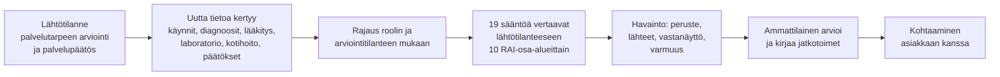
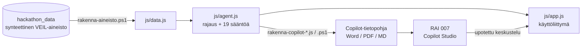

# RAI Muutosvahti

**AI ei päätä. AI huomaa. Ammattilainen arvioi.**

*Oikeat tiedot oikealle ammattilaiselle.* RAI Muutosvahti kokoaa ikääntyneen asiakkaan esitiedot sosiaali- ja terveydenhuollon tiedoista RAI-arvioinnin osa-alueittain. Kooste muodostetaan ammattilaisen roolin ja arviointitilanteen mukaan, ja jokaisesta muutoksesta näytetään peruste ja lähde.

SOTE AI Hackathon 2026 (Dipoli, 13.–14.10.2026) · Haaste 1.1: *Esitietojen koonti – oikeat tiedot oikealle ammattilaiselle*

> Kaikki aineisto on synteettistä. Säännöt ja raja-arvot ovat demon sääntöjä, eivät kliinisiä tai virallisia RAI-hälytysrajoja.

---

## Lyhyesti

| | |
|---|---|
| **Ongelma** | Ennen RAI-arviointia tai vastaanottoa ammattilainen etsii asiakkaan muuttuneen tilanteen hajallaan olevista käynneistä, diagnooseista, lääkityksestä, laboratoriotuloksista, kotihoidon käynneistä ja sosiaalihuollon päätöksistä. Työ vie aikaa, ja olennainen muutos voi jäädä huomaamatta. |
| **Ratkaisu** | Muutosvahti vertaa lähtötilanteen jälkeen kertynyttä tietoa lähtötilanteeseen. Se jäsentää tiedot kymmeneen RAI-osa-alueeseen ja nostaa esiin muutokset, joilla on peruste, ajankohta, lähteet, vastanäyttö ja varmuus. |
| **Kenelle** | Ikääntyneiden palvelujen ammattilaiset: sairaanhoitaja (RAI-arvioija), lääkäri, fysioterapeutti ja sosiaalityöntekijä. Ostajana hyvinvointialue. |
| **Erottuu** | Jokainen rooli näkee vain käyttötarkoitukseensa kuuluvat tiedot. Havainnot ovat sääntöpohjaisia ja jäljitettäviä, eivät mustan laatikon ennusteita. Ammattilainen arvioi jokaisen havainnon, ja virhehälytyksiä seurataan sääntökohtaisesti. |
| **Tila** | Toimiva prototyyppi hackathonin synteettisellä aineistolla (14 asiakasta). Toimii selaimessa ja työpöytäsovelluksena ilman asennuksia ja ilman verkkoyhteyttä. Mukana Microsoft Copilot Studio -tekoälyagentti **RAI 007**. |

---

## Ongelma

- **Tieto on hajallaan.** Ikääntyneen asiakkaan tiedot ovat terveysaseman käynneissä, diagnooseissa, lääkityksessä, laboratoriotuloksissa, käyntimuistiinpanoissa, kotihoidon käynneissä, palvelupäätöksissä ja suunnitelmissa. Ne ovat eri järjestelmissä ja eri ammattiryhmien kirjaamia.
- **RAI-arviointi on lakisääteinen ja toistuva.** Ikääntyneiden palveluissa toimintakykyä arvioidaan RAI-välineellä. Seuranta-arviota varten arvioijan on selvitettävä, mikä on muuttunut edellisen arvioinnin tai palvelupäätöksen jälkeen.
- **Esitietojen kokoaminen vie aikaa asiakastyöltä.** Kun tietoja etsitään käsin, muutos voi jäädä huomaamatta, esimerkiksi uusi kaatumistaipumus, lääkitysmuutos tai kotihoidon käyntimäärän kasvu.
- **Kaikki eivät saa nähdä kaikkea.** Fysioterapeutti ei tarvitse laboratoriotuloksia, eikä sosiaalityöntekijä tarvitse diagnooseja. Esitietojen koonnin on noudatettava käyttötarkoitussidonnaisuutta.

## Ratkaisu

1. **Rajaa tiedot.** Ammattilainen kirjautuu roolissaan ja valitsee arviointitilanteen. Agentti käsittelee vain ne tiedot, jotka roolin käyttöoikeudet ja tilanteen käyttötarkoitus sallivat.
2. **Muodostaa lähtötilanteen.** Lähtötilanteena käytetään palvelutarpeen arviointia ja palvelupäätöstä. Hackathonin aineistossa ei ole RAI-mittareita, joten sen jälkeen kertyneet tiedot jäsennetään RAI-arvioinnin osa-alueisiin.
3. **Tunnistaa muutokset.** Sääntöpohjainen agentti tunnistaa kielteiset muutokset, myönteiset muutokset ja seurattavat asiat.
4. **Näyttää perustelut.** Jokaisesta havainnosta näkyy, mitä muuttui ja milloin, mihin sääntöön havainto perustuu ja mistä lähteestä se tulee. Lisäksi näkyy, mikä tieto puhuu havaintoa vastaan ja kuinka varma havainto on (selvä, kohtalainen tai epävarma). Alkuperäisen lähdetiedon voi avata.
5. **Ammattilainen päättää.** Ammattilainen arvioi, pitääkö havainto paikkansa, onko se virhehälytys vai onko asia epäselvä. Sen jälkeen hän kirjaa jatkotoimet. Agentti ehdottaa tarkistettavia asioita ja rakenteisia kyselyjä (PHQ-9, GAD-7, AUDIT), mutta ei tee päätöksiä.

## Keskeiset ominaisuudet

| Ominaisuus | Kuvaus |
|---|---|
| **Koontinäkymä** | Omat asiakkaat järjestettynä muutosten määrän ja merkittävyyden mukaan. Värit kertovat vain tarkistamisen tarpeen, eivät asiakkaan riskiä. Mukana myös RAI-seuranta-arvion ajankohta ja myöhässä olevat arviot. |
| **Esitietokooste** | Tilannekuva, havainnot tärkeysjärjestyksessä ja kymmenen RAI-osa-aluetta (lähtötilanne vs. sen jälkeen). Osio *Valmistaudu kohtaamiseen* listaa tarkistettavat asiat. |
| **Roolikohtainen painotus** | RAI-seuranta-arviossa roolin keskeiset osa-alueet näytetään ensin ja muut erikseen avattavina. Painotus ei laajenna käyttöoikeuksia. |
| **Kaaviot** | Terveysaseman käynnit (kiireellisyys), kotihoidon käynnit, laboratoriotulokset ja säännöllinen lääkitys aikajanana, kukin lähtötilanteeseen verrattuna. Kaavio näkyy vain, jos rooli saa nähdä sen tiedot. |
| **Lähteen avaus** | Jokaisen havainnon alkuperäinen lähdetieto, kuten käyntimuistiinpano, diagnoosi tai lääkemuutos, aukeaa yhdellä napsautuksella. |
| **Ammattilaisen arvio ja jatkotoimet** | Arvio (pitää paikkansa / virhehälytys / epäselvä) ja jatkotoimet tallentuvat tekijän, roolin ja tilanteen kanssa. |
| **Rakenteiset kyselyt** | PHQ-9, GAD-7 ja AUDIT täytettävinä lomakkeina pisteytyksineen, kun ne kuuluvat roolin käyttötarkoitukseen. |
| **Säännöt ja laatu** | Kaikki 19 sääntöä perusteineen, käytettyine tietoineen ja tunnettuine rajoitteineen. Lisäksi sääntökohtainen virhehälytysaste ammattilaisten arvioista ja vinoumien arviointi. |
| **Käyttötarkoitus ja tietosuoja** | RBAC-matriisi, mitä ratkaisu ei tee, ihmisen valvonta, alustava sääntelyluokittelu ja tietojen minimointi. |
| **Käyttöloki** | Kuka avasi minkä asiakkaan, missä roolissa ja tilanteessa ja mitä teki. |
| **Tekoälyagentti RAI 007** | Copilot Studio -agentti upotettuna sovellukseen. Agentti vastaa roolin mukaisesti vain tietopohjansa perusteella, ja paneelissa kerrotaan, että käyttäjä keskustelee tekoälyn kanssa. |
| **Työpöytäsovellus ja mobiili** | Asennettava työpöytäsovellus (oma ikkuna ja kuvake) ja responsiivinen mobiilinäkymä. Vaalea ja tumma teema. Saavutettavuus: näppäimistökäyttö, ruudunlukijatekstit, värin lisäksi muodot. |

## Roolit ja käyttötarkoitussidonnaisuus

| Rooli | Arviointitilanteet | Painotetut RAI-osa-alueet | Ei näe |
|---|---|---|---|
| **Sairaanhoitaja** (kotihoito, RAI-arvioija) | RAI-seuranta-arvio, lääkehoidon arviointi | Kaikki osa-alueet | Asiakkaita, joihin ei ole hoitosuhdetta |
| **Lääkäri** | Lääkärin vastaanotto, lääkehoidon arviointi, RAI-seuranta-arvio | Terveydentila ja lääkitys, mieliala, kognitio, kipu, liikkuminen, palvelujen käyttö | Sosiaalihuollon päätös- ja suunnitelmatekstejä |
| **Fysioterapeutti** | RAI-seuranta-arvio | Arjessa selviytyminen, liikkuminen ja kaatumiset, kipu | Lääkitystä, laboratoriota, päätöstekstejä, kyselyjä |
| **Sosiaalityöntekijä** | RAI-seuranta-arvio, palvelutarpeen arviointi | Arki, liikkuminen, kognitio, kommunikointi, sosiaalinen osallistuminen, palvelut | Diagnooseja, lääkitystä, laboratoriota, kyselyjä |

Arviointitilanne voi rajata tietoja vielä roolia tarkemmin. Esimerkiksi lääkehoidon arvioinnissa sosiaalihuollon tekstit eivät ole mukana.

**RAI-osa-alueet:** arjessa selviytyminen ja avuntarve · liikkuminen ja kaatumiset · kognitio · kommunikointi ja aistit · mieliala ja uni · sosiaalinen osallistuminen ja elintavat · kipu · ravitsemus · terveydentila ja lääkitys · palvelujen käyttö.

**Säännöt (19):** kaatumistaipumus, tapaturmat ja vammat, huimaus, mielialakirjaukset, univaikeudet, kipukäynnit, toimintakyvyn kuvaus käyntimuistiinpanossa, kiireelliset käynnit, lääkitysmuutokset, laboratoriotulosten muutos, kuulo, kotihoidon käyntimäärän muutos, palveluprosessin muutos. Myönteiset muutokset: kiireelliset käynnit vähentyneet, ei kaatumis- tai vammakirjauksia, ei uusia mielialakirjauksia, laboratoriotulos kohentunut. Lisäksi RAI-seuranta-arvion ajankohta.

## Luotettavuus, turvallisuus ja sääntely

### Mitä ratkaisu ei tee

- Ei tee RAI-arviointia eikä muuta RAI-tuloksia.
- Ei tee diagnooseja, hoitopäätöksiä eikä palvelupäätöksiä.
- Ei pisteytä asiakkaan riskiä eikä luokittele asiakkaita.

### Läpinäkyvyys ja ihmisen valvonta

- Muutosten tunnistus on sääntöpohjaista. Se ei käytä koneoppimismallia eikä kielimallia eikä opi asiakastiedoista, joten jokainen havainto on toistettavissa ja jäljitettävissä.
- Jokaisella havainnolla on peruste, lähde, vastanäyttö ja varmuus. Ammattilainen arvioi jokaisen havainnon, ja sääntökohtainen virhehälytysaste näkyy *Säännöt ja laatu* -näkymässä. Raja-arvot kalibroidaan ammattilaisten kanssa.
- Vinoumat on arvioitu. Ikä, sukupuoli, kieli tai kotikunta eivät ole minkään säännön syötteenä, vaan asiakasta verrataan vain hänen omaan lähtötilanteeseensa. Tunnetut rajoitteet, kuten aliedustus ja ruotsinkieliset kirjaukset, on kirjattu.
- Tekoälyagentin paneelissa kerrotaan, että käyttäjä keskustelee tekoälyn eikä ihmisen kanssa (tekoälysäädös, art. 50).

### Sääntely (alustava arvio, vahvistetaan juristin ja tietosuojavastaavan kanssa)

- **EU:n tekoälysäädös:** järjestelmä käsitellään suuren riskin järjestelmänä (liite III), koska se tukee julkisten palvelujen tarpeen arviointia sote-tiedoilla.
- **MDR:** käyttötarkoitus rajaa pois diagnoosit ja hoitopäätökset, mikä puoltaa sitä, ettei kyse ole lääkinnällisestä laitteesta.
- **Tietosuoja:** hyvinvointialue on rekisterinpitäjä ja toimittaja käsittelijä. Käsittelyperuste on tietosuoja-asetuksen art. 6(1)(e) ja 9(2)(h), ja vaikutustenarviointi (DPIA) on pakollinen. Käyttöoikeudet määräytyvät hoitosuhteen perusteella, käytöstä jää loki, tiedot salataan ja käsitellään EU:ssa. Oikean aineiston käyttö kehitykseen edellyttää Findatan lupaa.
- **Tietojen minimointi demossa:** terveystiedot otetaan vain lähtötilannetta edeltävältä vuodelta ja sen jälkeen. Kotihoidon käynnit ovat kuukausitasolla. Henkilötunnuksia, nimiä tai lomakkeiden laatijatietoja ei ole.

## Hyödyt

| Kenelle | Hyöty |
|---|---|
| **Ammattilainen** | Esitiedot valmiina RAI-osa-alueittain ennen arviointia tai vastaanottoa. Olennaiset muutokset ovat ensin, ja lähde aukeaa yhdellä napsautuksella. Enemmän aikaa asiakkaan kohtaamiseen. |
| **Asiakas** | Muutos huomataan ennen seuraavaa määräaikaista arviointia, ja asiakkaan oma kokemus kysytään kohtaamisessa. |
| **Hyvinvointialue** | Yhtenäinen ja jäljitettävä esitietojen koonti eri ammattiryhmille, käyttötarkoitussidonnaisuus sisäänrakennettuna, myöhässä olevat RAI-seuranta-arviot näkyvissä ja laadunseuranta virhehälytysten kautta. |

## Liiketoiminta ja jatkokehitys

- **Markkina:** RAI-arviointia käytetään ikääntyneiden palveluissa koko maassa, joten jokainen hyvinvointialue on potentiaalinen asiakas. Ratkaisu ei ole sidottu yhteen potilastietojärjestelmään.
- **Malli (ehdotus):** palvelu hyvinvointialueelle lisenssinä (SaaS), esimerkiksi käyttäjä- tai asiakasmäärän mukaan. Tuotannossa käsittely EU:ssa hyvinvointialueen ympäristössä.
- **Monistettavuus:** säännöt, roolit ja arviointitilanteet ovat erillistä konfiguraatiota (`js/agent.js`). Uuden roolin, kuten toimintaterapeutin, tai uuden tilanteen voi lisätä muuttamatta käyttöliittymää.

### Tiekartta

1. Raja-arvojen kalibrointi sairaanhoitajien, lääkäreiden ja RAI-osaajien kanssa sekä virhehälytysten mittaus pilotissa.
2. Integraatio potilas- ja asiakastietojärjestelmiin ja Kanta-palveluihin standardirajapinnoilla (esim. FHIR) ja RAI-mittareiden käyttö lähtötilanteena.
3. Tunnistus Entra ID:llä, palvelinpuolen käyttöoikeudet ja lokitus, ei potilastietoa selaimessa.
4. Ruotsinkielisten kirjausten tuki ja lisää rooleja.
5. Vaatimustenmukaisuus: DPIA, tekoälysäädöksen suuren riskin velvoitteet ja MDR-arvion vahvistus.

---

## Tekninen toteutus

| Osa | Teknologia |
|---|---|
| **Käyttöliittymä** | HTML, CSS ja JavaScript ilman kehyksiä, riippuvuuksia tai build-vaihetta. Kaaviot SVG:nä omalla koodilla. Responsiivinen, vaalea ja tumma teema. |
| **Agentti (muutosten tunnistus)** | Sääntöpohjainen JavaScript-moduuli `js/agent.js`: rooli- ja tilannekohtainen rajaus (RBAC), 10 RAI-osa-aluetta, 19 sääntöä, sääntöversio `luvn-2026.10`. |
| **Tekoälyagentti** | Microsoft Copilot Studio -agentti **RAI 007** upotettuna verkkokeskusteluna. Tietopohja (Word, PDF ja Markdown) generoidaan sovelluksen omalla agentilla, joten agentin vastaukset vastaavat sovelluksen roolinäkymiä. |
| **Aineistoputki** | PowerShell 5.1 (`tools/rakenna-aineisto.ps1`): hackathonin aineisto → `js/data.js` ja `data/aineisto.json`, tietojen minimointi samalla. Node.js- ja PowerShell-skriptit Copilot-tietopohjan rakentamiseen. |
| **Kirjautuminen (demo)** | Salasanat suolattuina SHA-256-tiivisteinä (Web Crypto). Kirjautuminen lukittuu viiden virheellisen yrityksen jälkeen. Istunto ja arviot tallennetaan selaimen paikalliseen muistiin. |
| **Työpöytäsovellus** | Microsoft Edgen sovellustila: oma ikkuna, oma kuvake, ei osoiteriviä, ei asennettavia ohjelmia. |
| **Ajoympäristö** | Mikä tahansa moderni selain. Toimii ilman verkkoyhteyttä; vain RAI 007 -agentti tarvitsee verkon. |

### Projektin rakenne

| Polku | Sisältö |
|---|---|
| `index.html` | Etusivu ja roolikohtainen kirjautuminen |
| `login.html` | Kirjautuminen ja sovellus |
| `js/agent.js` | Sääntöpohjainen agentti: roolit, tilanteet, RAI-osa-alueet, säännöt |
| `js/app.js` | Käyttöliittymä: koontinäkymä, esitietokooste, kaaviot, arviot, lomakkeet, säännöt ja laatu, tietosuoja, loki, tekoälyagentti |
| `js/asetukset.js` | Tekoälyagentin nimi ja upotusosoite |
| `js/data.js`, `data/aineisto.json` | Sovelluksen aineisto (generoitu) |
| `css/styles.css` | Ulkoasu, teemat, mobiili |
| `agent/` | RAI 007 -agentin ohjeet Copilot Studioon |
| `data/copilot-*` | RAI 007 -agentin tietopohja (koko aineisto, roolikohtaiset ja asiakaskohtaiset tiedostot) |
| `new_data/roolit/` | Roolien ja arviointitilanteiden kuvaukset, joihin roolipainotus perustuu |
| `tools/` | Aineiston ja Copilot-tietopohjan rakentaminen, työpöytäsovelluksen asennus |

---

## Kokeile

**Selaimessa:** avaa `index.html`. Ei asennuksia eikä build-vaihetta.

**Sovellustilassa:** `kaynnista-sovellustilassa.cmd` avaa demon Edgessä omaan ikkunaansa.

**Työpöytäsovelluksena:** kaksoisnapsauta `asenna-tyopoytasovellus.cmd`. Se luo työpöydälle ja Käynnistä-valikkoon kuvakkeen **RAI Muutosvahti**. Jos projektikansio siirretään, aja asennus uudelleen. Poisto: `asenna-tyopoytasovellus.cmd -Poista`.

**Demotunnukset** (salasana kaikille `Muutosvahti2026`, tai valitse rooli etusivulta):

| Tunnus | Rooli | Hoitosuhde |
|---|---|---|
| `sanna` | Sairaanhoitaja, kotihoito | 11 kotihoidon asiakasta |
| `lauri` | Lääkäri | kaikki 14 |
| `fiia` | Fysioterapeutti | kaikki 14 |
| `sofia` | Sosiaalityöntekijä | kaikki 14 |

### Demon kulku (3–5 min)

1. **Sairaanhoitaja (`sanna`)** → koontinäkymä: asiakkaat muutosten mukaan järjestettynä.
2. **Asiakas 9422:** kaatumistaipumus kirjattu lähtötilanteen jälkeen, kaatumisen pelko rajoittaa liikkumista, kotihoito päättynyt 31.5.2026 → avaa lähde (käyntimuistiinpano) → arvioi havainto ja kirjaa jatkotoimet.
3. **Lääkäri (`lauri`)** → **Asiakas 3245:** uusi ahdistuneisuuskirjaus ja essitalopraami → täytä GAD-7.
4. **Sosiaalityöntekijä (`sofia`)** samaan asiakkaaseen: diagnoosit ja lääkitys on rajattu pois, näkyvissä palveluprosessi ja toimintakyky.
5. **Säännöt ja laatu** ja **Loki:** jokaisella havainnolla on peruste, ja jokainen toimenpide jää lokiin.
6. **RAI 007:** kysy agentilta saman asiakkaan tilanteesta roolisi näkökulmasta.

---

## Aineisto

Sovellus käyttää vain hackathonin synteettistä aineistoa (`hackathon_data`):

- **LUVN_synteettinenData_VEIL (2024–2026):** 14 ikääntyneiden palvelujen asiakasta, joilla on myönteinen kotihoito- tai palveluasumispäätös sekä sosiaali- että terveystietoja. Tiedot kattavat käynnit, diagnoosit, lääkityksen, laboratoriotulokset, käyntimuistiinpanot, vireilletulot, päätökset, palvelut, kotihoidon käynnit ja suunnitelman.
- **Esitietolomakkeet:** PHQ-9, GAD-7 ja AUDIT (kysymykset ja pisteet aineistosta).

Viitepäivä on 13.10.2026, ja sitä myöhemmät tiedot jätetään pois. Aineiston rakentaminen: `.\tools\rakenna-aineisto.ps1` (PowerShell 5.1). Valittavissa olevat asiakkaat saa listattua valitsimella `-Ehdokkaat`.

## Demo vs. tuotanto

Tämä on hackathon-prototyyppi. Kirjautuminen on selainpohjainen simulaatio eikä oikea tunnistus, ja tiedot tallennetaan selaimen paikalliseen muistiin. Tuotannossa tunnistus tehdään hyvinvointialueen Entra ID:llä, käyttöoikeudet ja tiedot ovat palvelimella, eikä potilastietoa tallenneta selaimeen.
